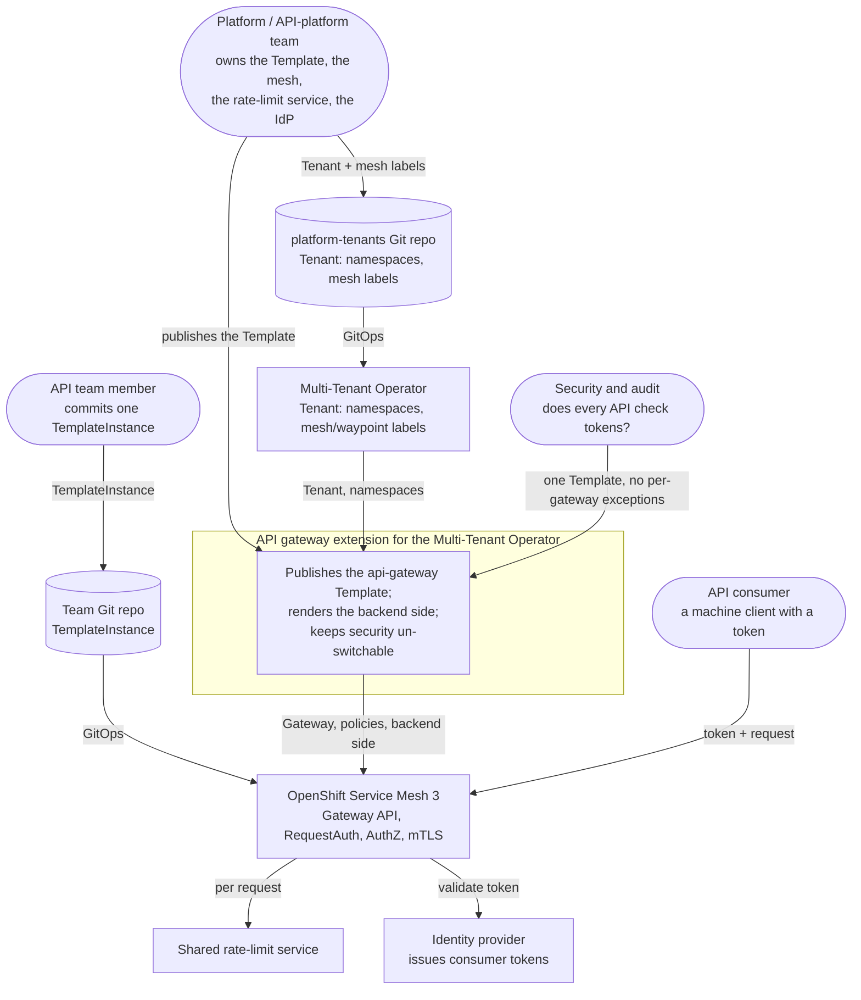
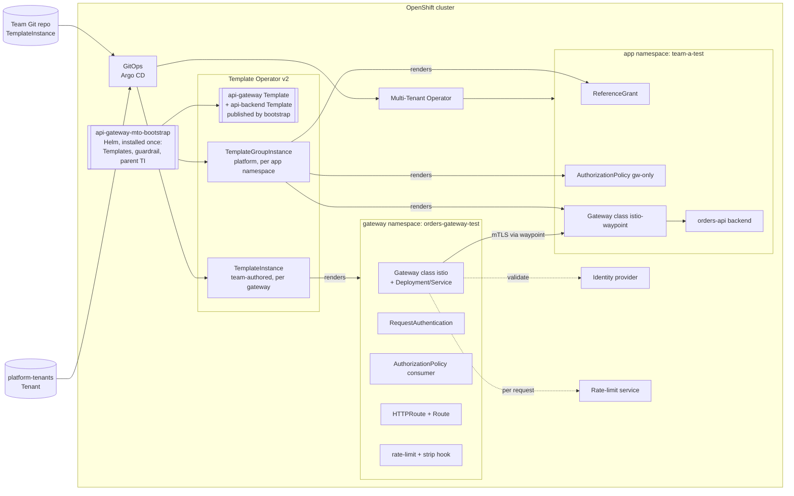

# Diagrams

C4 views (context → container) and the main flows. Mermaid.

## C4 — Context



The extension renders objects; it runs no gateway, rate-limit service or
identity provider of its own (ADR-0001). Security configuration lives in the
Template, not in the team's `TemplateInstance` (ADR-0002).

## C4 — Container



## Sequence — a request through the gateway

```mermaid
sequenceDiagram
  autonumber
  participant C as Consumer (machine client)
  participant IDP as Identity provider
  participant R as OpenShift Route
  participant GW as Gateway (Envoy)
  participant RL as Rate-limit service
  participant WP as Waypoint (team-a-test)
  participant BE as orders-api
  C->>IDP: client-credentials grant
  IDP-->>C: access token (claim allowed_apis)
  C->>R: HTTPS GET /v2/orders/42 + token
  R->>GW: re-encrypt to the gateway
  GW->>GW: validate token (issuer, JWKS, audience)
  GW->>GW: require claim allowed_apis matches api-orders-consumer-*
  GW->>GW: strip caller x-sub/x-roles; set its own from the token
  GW->>RL: under the medium tier limit?
  RL-->>GW: yes
  GW->>GW: rewrite /v2 -> /v1
  GW->>WP: forward over mTLS (HBONE)
  WP->>BE: gw-only allows the gateway identity
  BE-->>C: 200
  Note over GW: no token -> 403; wrong-API token -> 403; invalid -> 401; flood -> 429
```

## Sequence — a team requests a gateway

```mermaid
sequenceDiagram
  autonumber
  participant D as API team member (ola)
  participant G as Team Git repo
  participant GO as GitOps
  participant T as Template Operator v2
  participant API as Kubernetes API + admission
  D->>G: commit TemplateInstance (apiName, backend, host, tier)
  G->>GO: sync
  GO->>T: apply TemplateInstance in orders-gateway-test
  T->>API: render Gateway, RequestAuth, AuthZ, routes, hooks (as the platform identity)
  API-->>T: admitted (platform identity; a team-written Gateway would be refused)
  Note over T: security is in the Template; ola set only API-shaped parameters
  Note over T: the backend side (gw-only, waypoint) comes from the platform TemplateGroupInstance
```

## Sequence — a team tries to route around the Template

```mermaid
sequenceDiagram
  autonumber
  participant O as ola (team-a owner)
  participant API as Kubernetes API + admission
  participant T as Template Operator v2
  O->>API: create a raw Gateway with no token check in orders-gateway-test
  API-->>O: refused — only the platform identity may create a Gateway (ADR-0006)
  O->>API: edit the rendered AuthorizationPolicy to drop the token requirement
  API-->>O: the edit is reverted (sync.mode: revert); and admission refuses the edit
  Note over O,T: the Template is the only way to an ingress gateway
```
