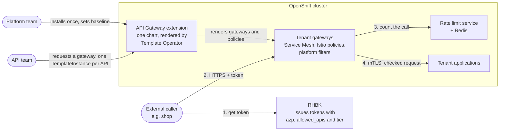
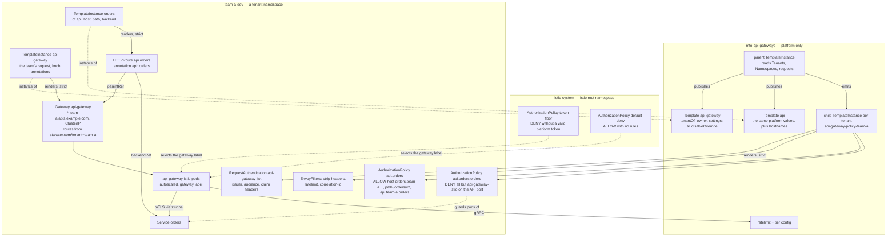
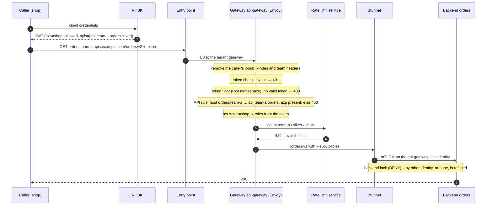
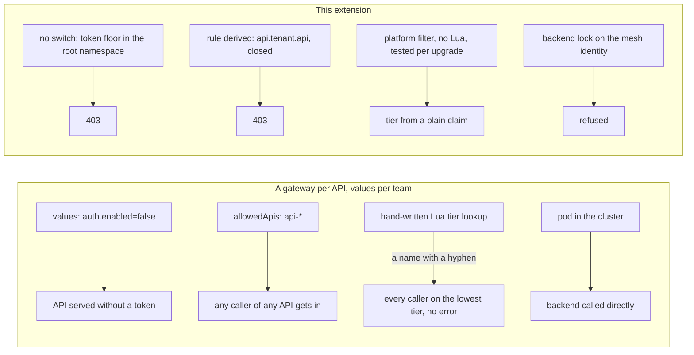

# Diagrams

Mermaid diagrams of the design in `design.md`. Running example: tenant
`team-a`, API `orders` in `team-a-dev` on `orders.team-a.apis.example.com`,
caller `shop`.

## C4 — Context



## C4 — Container



## Request flow



## Request a gateway, publish an API

```mermaid
sequenceDiagram
  autonumber
  participant P as Platform
  participant M as Multi-Tenant Operator
  participant T as Template Operator
  participant S as Service Mesh
  participant D as Team team-a
  P->>T: install the bootstrap chart once (mto-api-gateways)
  T->>T: root-namespace floor and default deny; parent publishes api-gateway
  P->>M: create Tenant team-a (namespaces, mesh labels)
  M->>M: label namespaces stakater.com/tenant=team-a
  T->>T: parent adds team-a's namespaces to tenantOf
  D->>D: create TemplateInstance api-gateway in team-a-dev (no parameters)
  T->>T: parent: owner of team-a = team-a-dev/api-gateway; emits team-a's child
  T->>D: Gateway api-gateway + settings + status ok (strict)
  T->>D: child: RequestAuthentication, platform filters
  S->>S: deploy api-gateway-istio with autoscaler
  D->>D: a second request in team-a-test gets status refused, naming the owner
  D->>D: create TemplateInstance orders of api: host orders.team-a…, path /orders/v2, Service orders
  T->>D: HTTPRoute api.orders + status api.orders (strict)
  T->>D: child: ALLOW api.orders on host + path, and backend lock (only if no other API's path overlaps and every backend can be locked)
  Note over D: shop gets 200, others 401, 403 or 429
```

## Offboard

```mermaid
sequenceDiagram
  autonumber
  participant D as API team
  participant P as Platform
  participant T as Template Operator
  D->>D: delete TemplateInstance orders
  T->>D: delete HTTPRoute api.orders; the child no longer lists orders
  T->>D: delete ALLOW api.orders and backend lock api.orders.orders
  D->>D: delete TemplateInstance api-gateway (or the platform deletes Tenant team-a)
  T->>D: delete Gateway api-gateway and its settings; the parent removes team-a's child and its policies
  Note over T: with the tenant gone, tenantOf drops its namespaces, so no request of it renders a gateway
  Note over T: only objects with the ownership labels are deleted; a taken name must stop the render first (T4, issue #11)
```

## The gaps this design closes


