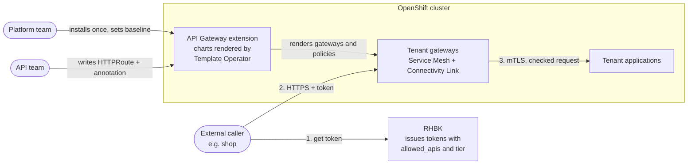
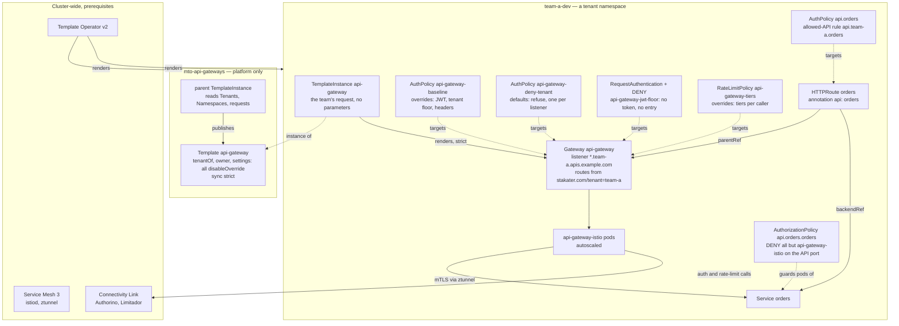
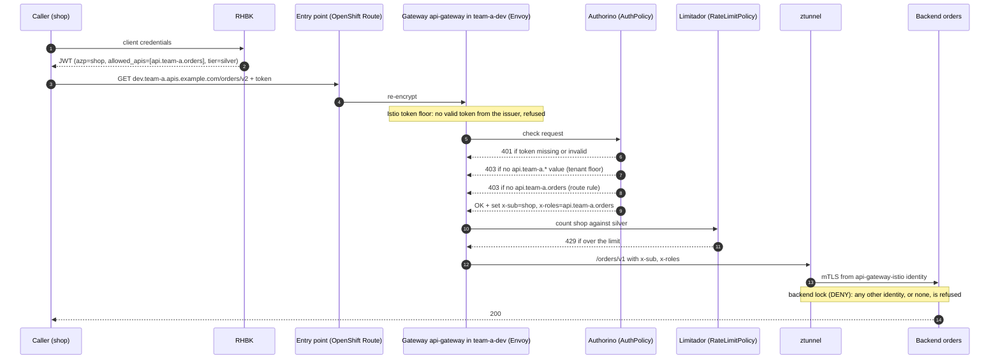
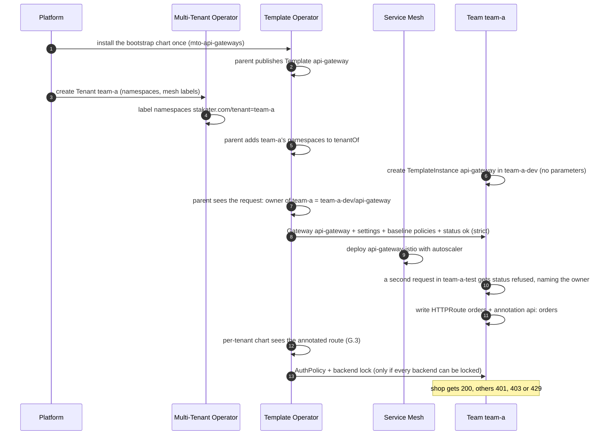
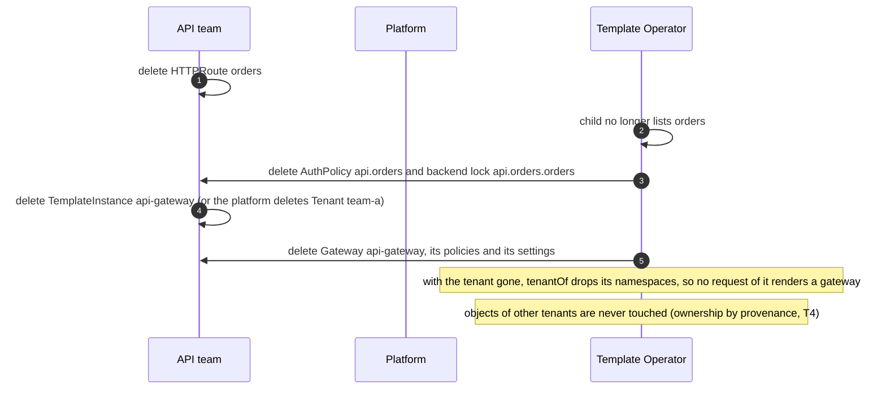
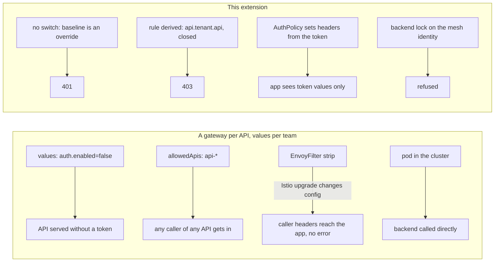

# Diagrams

Mermaid diagrams of the design in `design.md`. Running example: tenant
`team-a`, API `orders` in `team-a-dev`, caller `shop`.

## C4 — Context

## C4 — Container

## Request flow

## Request a gateway, publish an API

## Offboard

## The gaps this design closes

