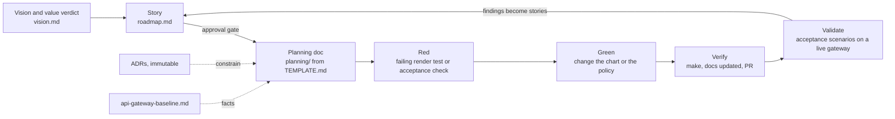

# Method — story → plan → red → green → verify → validate

How this extension is built. Adapted from the KubeWard method
(`stakater-ab/kube-ward` `docs/method.md`), itself a customised BMAD: brief and
PRD ↔ `vision.md` and `roadmap.md`, architect ↔ ADRs, story files ↔ story +
planning-doc pairs, QA gate ↔ `make` and acceptance scenarios. Same method as
`mto-extension-service-mesh`, `mto-extension-keycloak`, `mto-extension-quay`
and `mto-extension-kasten`.

## The loop

The **inner loop** ships one story. The **outer loop** validates on a live
OpenShift Service Mesh against `acceptance.md`. "The token check can't be
switched off" is proven by a `403` on a tampered gateway, not by a green golden
file.

## Practices and where each is enforced

| Practice | Here | Enforced by |
|---|---|---|
| Value first | the verdict at the top of `vision.md`; a story that doesn't serve the secure gateway, the backend side or the governance is questioned | review against `vision.md` |
| Spec first | vision → story → planning doc before chart changes | workflow in CLAUDE.md; planning doc committed first |
| Immutable decisions | `docs/adr/`, superseded never edited | review |
| Story-driven | house format, Done line, acceptance ids, lifecycle | roadmap; PRs cite the story |
| Test first | a failing render test (golden, schema, "no such parameter" guard) or acceptance check before the change | `make` (once the charts exist); review |
| Facts before design | gateway behaviour cited to `api-gateway-baseline.md` rows; unknowns marked VERIFY | review; M.0 |
| Live validation | acceptance scenarios on OpenShift Service Mesh 3.4 ambient, with the rate-limit service, an identity provider, the Multi-Tenant Operator and Template Operator v2 | validation report per phase |
| Deterministic first | everything rendered from the `TemplateInstance` and the `Tenant`; no run-time decision | render tests |
| Honesty | "not verified" beats a confident guess; the `EnvoyFilter` risk is stated, not hidden | review |

## Story lifecycle

📝 Draft → 👍 Approved → 🔨 In progress → ✅ Done. A Draft must never be built.
Killing a weak Draft is the method working — and so is deciding, after M.0,
that the rate-limit path is too fragile and narrowing the scope.

## The planning doc is a context capsule

`planning/TEMPLATE.md` is the contract: a cold session, with no memory of this
conversation, must be able to execute the story from the planning doc alone —
the why, the governing ADRs and baseline rows, the exact files, the tests (red
first, including the "no such parameter" guards that make security
un-switchable), and what is out of scope.

## When the gateway stack changes

1. Update `api-gateway-baseline.md` (version, changed rows, new VERIFY items).
   Re-check **D4/Q1** (does a supported rate-limit path now exist?) and **X1**
   (does the service-mesh extension still exempt platform identities?).
1. Re-run the acceptance suite on the new version.
1. Supersede any ADR whose context changed.
